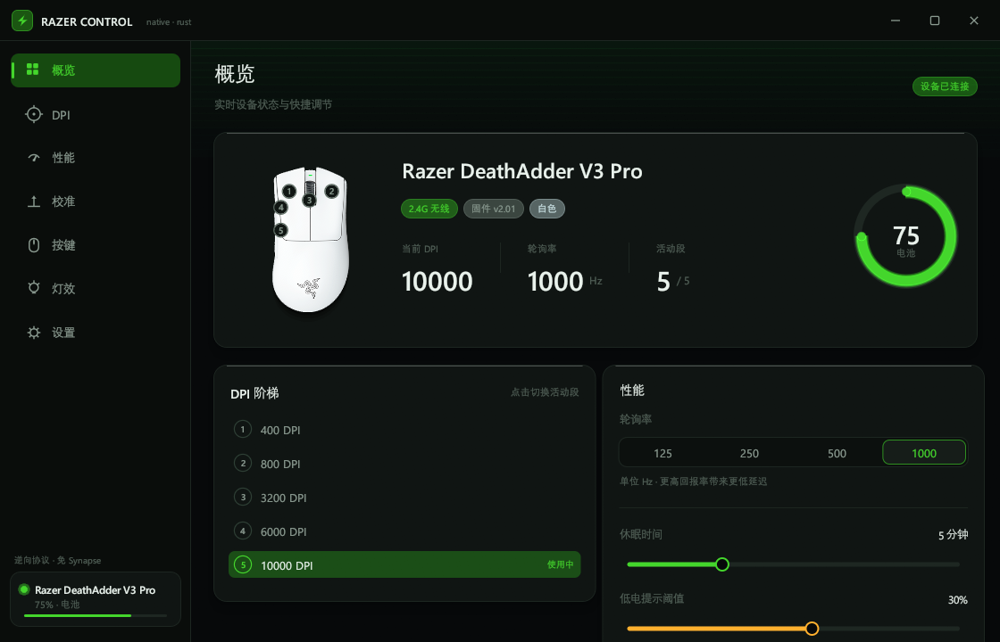
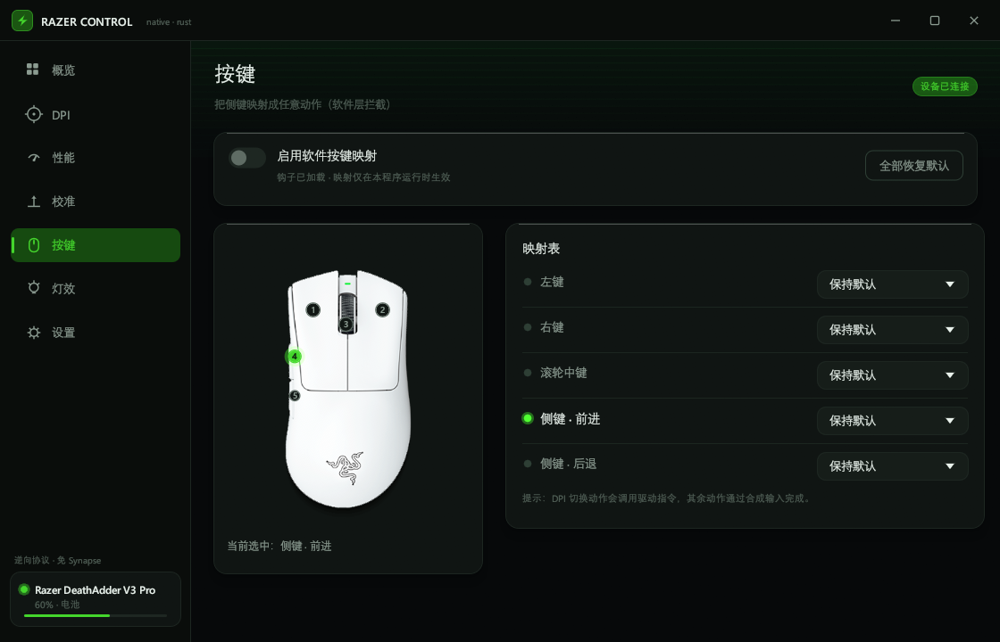

# RazerControl — 纯 Rust 的雷蛇鼠标原生驱动

> 从 `C:\Program Files\Razer\RazerAppEngine\app-4.0.699\RazerAppEngine.exe`（Synapse 4）逆向出设备控制协议，
> 用 Rust 重新实现了一套**不依赖 Razer 软件**的驱动 + 原生 GPU 界面（egui，非网页）。
>
> 真机验证：**Razer DeathAdder V3 Pro（1532:00B7，2.4G 无线）**，固件 v2.01；
> **Razer DeathAdder V2 Pro（1532:007D 无线 / 007C 有线）**，固件 v2.05。



## 1. 逆向过程

### 1.1 目标结构

`RazerAppEngine.exe` 是 **176 MB 的 Electron/CEF 外壳**（`resources.pak`、`icudtl.dat`、
`v8_context_snapshot.bin`、`libGLESv2.dll`）。真正有意思的东西在两个地方：

| 位置 | 内容 |
| --- | --- |
| `resources\app.asar`（89 MB，8557 个文件） | Electron 主进程：`electron/UsbRzDeviceAction.js`、`electron/Protocol/protocol25.js`、`electron/SPEC_UsbRzDeviceAction_protocol25_flow.md` |
| `resources\app.asar.unpacked\node_modules\node-rz-hid\build\Release\HID.node` | 原生 HID 绑定（hidapi） |
| `C:\Windows\System32\drivers\RzCommon.sys` + `RzDev_00b6.sys` | KMDF 驱动，创建虚拟 HID 设备（`RzDevice::IoInternalDeviceControl`） |

asar 按 V8 pickle 头解析（`[u32=4][u32 hdr][u32 json-8][u32 json][json…][data…]`），
其中 `SPEC_UsbRzDeviceAction_protocol25_flow.md` 直接给出了传输层语义：

* 90 字节负载 → **前面补一个 report id 字节 → 91 字节 Feature Report**；
* 每设备互斥锁、batch 帧 5 ms 间隔、65 字节老协议分支。

但**帧内命令字并不在 asar 里** —— 上层 UI 是远端加载的 web 前端，原始字节由它拼好后
经 IPC 下发。所以命令字是我在真机上**逐条探测出来的**。

### 1.2 关键突破：只读权限被独占，写句柄却能读

控制接口是 `usage page 0x0001 / usage 0x0002`、Feature Report 长度 91 的 HID 接口。
Razer 的内核驱动对它做了独占：

```
CreateFile(path, GENERIC_READ)          -> ERROR_ACCESS_DENIED (5)
CreateFile(path, GENERIC_WRITE)         -> OK
HidD_SetFeature(handle_write_only, 91)  -> OK
HidD_GetFeature(handle_write_only, 91)  -> OK      <-- 不需要读权限
```

于是不需要卸载 Synapse、不需要卸载驱动、不需要管理员权限，就能与设备对话。

另一处坑：第一帧应答的 `status` 往往是 `0x01`(busy)，必须**轮询** `HidD_GetFeature`
直到 `status=0x02`，并且要用 `transaction_id` 过滤掉别人（Synapse）的应答。

## 2. 协议（实测得出）

```
report id 0x00 + 90 字节负载
[0]      status            0x00 = 新命令
[1]      transaction_id    递增，应答原样带回
[2..4]   remaining_packets LE16
[4]      protocol_type     0xFF
[5]      data_size
[6]      command_class
[7]      command_id
[8..88]  arguments[80]
[88]     crc = XOR(payload[2..88])
[89]     reserved
```

应答状态：`0x01` 忙（重试）、`0x02` 成功、`0x03` 失败、`0x05` 不支持。

| 功能 | class/id | 说明 |
| --- | --- | --- |
| 固件版本 | `0x00/0x81` | args = `[major, minor]` → **v2.01** |
| 序列号 | `0x00/0x82` | 22 字节 ASCII → `PM2527H27802009` |
| 版本/配色 | `0x00/0x86` | `args = [layoutId, editionId]`；`0x00` 黑、`0x80` 白（见 [4.3](#43-配色识别颜色是设备自己上报的)） |
| 连接模式 | `0x00/0x84` | `args[0]`；`0x03` = 2.4G，但休眠时会漂成 `0x00`，所以连接方式以 PID 为准 |
| 轮询率 | `0x00/0x85` 读、`0x00/0x05` 写 | 1/2/4/8/16/32/64 ↔ 1000/500/250/125/2000/4000/8000 Hz |
| DPI | `0x04/0x85` 读、`0x04/0x05` 写 | args 7 字节：`[00][xHi][xLo][yHi][yLo][00][00]` |
| DPI 阶梯 | `0x04/0x86` 读、`0x04/0x06` 写 | `[00][活动段][段数]` + 每段 7 字节 `[n][xHi][xLo][yHi][yLo][00][00]` |
| 电量 | `0x07/0x80` | `args[1]` = **0..255 原始值**（×100/255 才是百分比，Synapse 同此换算） |
| 充电状态 | `0x07/0x84` | `args[1]` = `0x01` 充电中 / `0x00` 放电（`args[0]` 恒为 0） |
| 休眠时间 | `0x07/0x83` 读、`0x07/0x03` 写 | BE16 秒 |
| 低电阈值 | `0x07/0x81` 读、`0x07/0x01` 写 | 1 字节 0..255 ↔ 0..100% |
| 亮度 | `0x0F/0x83` 读、`0x0F/0x03` 写 | 仅 RGB 设备 |
| 灯效 | `0x0F/0x02` 写 | 静态色 `[01][01][01][r][g][b][00][00][00]` |
| 亮度（V2 Pro） | `0x0F/0x84` 读、`0x0F/0x04` 写 | args `[01][04][value]`，0..255 ↔ 0..100% |
| 灯效（V2 Pro） | `0x0F/0x02` 写 | 静态色 `[01][04][01][00][00][01][r][g][b]`，LED `0x04` = LOGO |
| 校准 · 追踪距离 | `0x0B/0x0B` 写 | `[00,04,01,v]` size 4，v=0/1/2 → 低/中等/高（写 3 被拒） |
| 校准 · 非对称中止 | `0x0B/0x0B` 写 | `[00,04,04,v]` size 4，v=0/1 |
| 校准 · 抬升/着陆 | `0x0B/0x05` 写 | `[00,04,lift,land,0×6]` size 10；抬升 1..26、着陆 1..25；**仅在非对称中止开启时接受** |
| 校准 · 读回 | — | **设备不回读**（`0x0B/0x85` 只是回显），值需本地保存 |
| 0x0F 传感器组 | `0x0F/0x89`、`0x0F/0x8B` | 本型号一律 `0x03`；那是 194/195 那代的接口 |

DeathAdder V3 Pro 的五段阶梯实测为 `400 / 800 / 3200 / 6000 / 10000`，
切换活动段会立即改变实时 DPI（写入阶梯表后 `0x04/0x05` 也会生效）。

## 3. 工程结构

```
razer-driver/
├─ rz-core/            # 驱动核心：零依赖，手写 Win32 FFI
│  ├─ hid.rs           # SetupAPI 枚举 + hid.dll Feature Report 收发（写句柄 + 轮询读）
│  ├─ proto.rs         # 91 字节帧构造/解析、XOR 校验
│  ├─ device.rs        # 类型化命令：DPI/阶梯/轮询/电量/休眠/阈值/灯效
│  └─ devices.rs       # PID → 能力表（最大 DPI、是否 RGB、轮询上限）
├─ rz-cli/             # rzctl：命令行验证工具，同一套协议
└─ rz-app/             # RazerControl：原生 GUI（egui/eframe + glow）
   ├─ theme.rs         # 设计系统：配色/字体/卡片/柔和投影/光斑
   ├─ widgets.rs       # 全自绘控件：滑杆、开关、分段选择、环形电量、图标
   ├─ art.rs           # 鼠标矢量插画（贝塞尔路径，可点击热区）
   ├─ pages/mod.rs     # 概览 / DPI / 性能 / 按键 / 灯效 / 设置
   ├─ backend.rs       # 设备工作线程（所有 HID I/O 不阻塞 UI）
   └─ hook.rs          # WH_MOUSE_LL 软件按键映射 + SendInput
```

零第三方依赖的部分：HID、Win32、JSON 配置解析全部手写；
只有 GUI 用到 `eframe/egui`。

## 4. 界面

| DPI 阶梯（拖动即写入设备） | 按键映射（在产品图上点选） |
| --- | --- |
|  |  |

| 灯效（无灯区设备的空态） | 设置 |
| --- | --- |
|  |  |

| 校准（智能追踪 / 追踪距离） | 托盘右键菜单 |
| --- | --- |
|  |  |

* 自定义无边框窗口 + 自绘标题栏、拖动、最小化/最大化/关闭（`ViewportCommand`）。
* 全部控件自绘：滑杆（拖拽写设备）、开关、分段选择、环形电量弧（带光晕与圆角端帽）。
* 中文排版：运行时加载系统 Segoe UI + DengXian，字体缺失自动回退。
* 卡片柔和投影、顶部冷光渐变、hover 高亮、右下角 toast 提示。

### 4.1 托盘与关闭行为

与 Synapse 一致：**只有托盘右键菜单里的「退出」才是真退出**，其余一切「关闭」动作都只是收进托盘。

| 操作 | 行为 |
| --- | --- |
| 标题栏关闭按钮 | `ShowWindow(SW_HIDE)` → 托盘 |
| **任务栏右键 → 关闭窗口** | 子类化窗口过程拦下 `WM_CLOSE` → 托盘 |
| **Alt+F4** | 同上（也是 `WM_CLOSE`） |
| 托盘右键 → 退出 | 置「允许关闭」标志后重发 `WM_CLOSE`，winit 结束事件循环 |

实现要点（`tray.rs`）：用 `SetWindowLongPtrW(GWLP_WNDPROC)` 把主窗口过程替换成自己的 `close_hook`，
`WM_CLOSE` 且未授权时直接 `SW_HIDE` 并返回 0（winit 完全收不到这条消息），其余消息原样转给
`CallWindowProcW` 保存的原过程。退出时先置 `ALLOW_CLOSE`，再 `PostMessage(WM_CLOSE)`，
另外挂一个 2 秒兜底的 `process::exit(0)`，保证托盘「退出」永远不会卡住。

* 托盘图标：`Shell_NotifyIconW` + 隐藏消息窗口 + 自绘 `WndProc`（`tray.rs`，无第三方 crate）；
  图标是运行时用 32×32 BGRA 位图拼出的 ICO（`CreateIconFromResourceEx`），Razer 绿闪电。
* 左键单击 / 双击图标 → 恢复主窗口；右键 → 菜单「显示主界面 / 退出 RazerControl」。
* 只有菜单里的「退出」才真正结束进程（向主窗口 `PostMessage(WM_CLOSE)`）。
* 最小化时弹一个气泡提示；`TaskbarCreated` 消息用于 explorer 重启后重新挂载图标。
* 注意：`ViewportCommand::Visible(false)` 在无边框窗口上不生效，这里直接 `ShowWindow(SW_HIDE/SW_SHOW)`。
* 任务栏图标用**原生尺寸**（100% DPI → 32×32）并按系统 DPI 选，避免 Windows 把 256 缩成 32 发虚：


### 4.2 型号产品图

界面里的鼠标不是手绘矢量图，而是**该型号的官方产品图**，运行时处理成可嵌入的纹理：

1. 素材 `assets/device_dav3pro.png`（黑）与 `assets/device_dav3pro_white.png`（白）——
   Razer 官方顶视渲染，编译期 `include_bytes!` 打进 exe；**用哪个由设备上报的 `editionId` 决定**
   （`0x00/0x86` 的 `args[1]`：`0x00` 黑色 / `0x80` 白色，与 Synapse 日志里的 `"editionId":128` 一致）；
   DeathAdder V2 Pro 使用 `device_dav2pro.png`（目前仅有官方黑色渲染，白色版回退黑色），按 PID `007C/007D` 选择，
   裁剪框与 5 个按键热点在 `photo.rs` 中按型号独立定义；
2. **白底抠图**用「从四边泛洪」而不是全局阈值 —— 只删掉与画布边缘连通的白色区域，
   机身内部的高光不会被戳出洞；边缘再做一次按亮度分级的羽化，消掉白边锯齿；
3. 黑色机身在深色主题里会「糊」进背景，所以对非透明像素做 `gamma 0.80` 提亮；
4. 按 `CROP` 框裁掉多余留白，等比绘制，并用同一纹理按不同 alpha 偏移三次合成**贴合轮廓的投影**；
5. 5 个按键热区（左/右/中/侧键×2）以归一化坐标定义，随图片缩放自动对齐，
   没有该型号素材的 PID 自动回退到手绘矢量插画。

当无线鼠标休眠、命令全部超时时，界面显示「休眠中 · 移动鼠标唤醒」，数值降级为 `—`，并保留上一次有效读数的本地缓存。
而不是把 0 当成真实读数：


### 4.3 配色识别：颜色是设备自己上报的

黑白两种配色在 Windows 里的产品名、VID/PID **完全一样**（本机白色版读出来也是
`Razer DeathAdder V3 Pro` / `1532:00B7`），所以官方没法靠字符串判断颜色，它读的是设备里的一条字段：

```powershell
rzctl raw 00 86 0000 2
# status=成功  args=[00, 80]      ← args[0] = layoutId, args[1] = editionId = 128
```

`Edition Information`（`0x00/0x86`，2 字节）返回 `[layoutId, editionId]`：

| editionId | 配色 |
| --- | --- |
| `0x00` (0) | 黑色 |
| `0x80` (128) | 白色（本机实测） |

Synapse 自己的日志里能直接对上（`%LOCALAPPDATA%\Razer\RazerAppEngine\User Data\Logs`）：

```json
{"serialNumber":"PM2527H27802009","editionId":128,"layoutId":0,"activeProfile":"5349ed08-..."}
```

它还用这个值做另外两件事：

* **多设备状态帧**每台设备 4 字节：`[isConnect, pid_hi, pid_lo, editionId]` —— 一个包就能列出
  所有鼠标和各自的配色；
* **遥测**打包成 `{PID, EID, VID, SN, SKU}`（`EID` 就是 editionId），用来统计配色分布。

本项目的做法：读一次 `0x00/0x86` 存进 `DeviceState.edition`，`photo()` 据此选白色/黑色渲染图，
并在型号名旁显示 `白色` / `黑色` 标签；换别的配色只需补一张素材 + 一个 `editionId` 分支。

> **坑**：后台每 3 秒的局部刷新只带电量/DPI，它是从 `DeviceState::default()` 拼出来的，
> `edition = 0` 会把读到的 `0x80` 覆盖回黑色。`merge()` 里必须显式保留 `new.edition = o.edition;`。

## 5. 构建与运行

需要 Rust（任意近期 stable）+ MinGW 或 MSVC 工具链。

```powershell
cd razer-driver
cargo build --release -p rz-app     # -> target/release/RazerControl.exe
cargo build --release -p rz-cli     # -> target/release/rzctl.exe
```

命令行工具：

```powershell
rzctl                       # 枚举接口 + 打印完整状态快照
rzctl dpi 1600              # 设置 DPI（立即写入设备）
rzctl poll 500              # 轮询率
rzctl sleep 5               # 休眠 5 分钟
rzctl lowbatt 20            # 低电阈值 20%
rzctl stage 3               # 切换到第 3 段
rzctl stagedpi 2 1200       # 修改第 2 段
rzctl raw 04 86 00 1        # 任意命令探测：class id hex-args size
```

## 6. 已验证 / 未覆盖

已实测通过（DeathAdder V3 Pro / V2 Pro）：

* **DeathAdder V2 Pro（007D 无线，固件 v2.05）**：DPI 800、4 段阶梯 `[400, 800, 1000, 1300]`、
  1000 Hz、电量 29%、休眠 300 s、低电阈值 5% 全部正确读回；LOGO 亮度 `0 → 40 → 0` 写入并回读一致，
  静态色 `#00FF00` 下发成功；
* **Mouse Dock（007E）** 也暴露 91 字节控制接口，程序按 PID / 产品名跳过，不会被误选成鼠标；
* **硬件 DPI 键切换活动段**：后台清醒时每 250ms 读一次实时 DPI，DPI 变化时立即补读阶梯表，
  界面在 0.6 秒内同步实时 DPI 和活动段（实测用 `rzctl stage 1/3` 模拟，600ms 后界面已更新）。
  Synapse 看起来更快，是因为它注册了鼠标的 `hardwareEventReportID`（report 5）主动事件；
  本程序只读 Feature Report，250ms 轮询是当前实现下的折中。
* GUI 点击「激活」→ 设备活动段与实时 DPI 同步改变（3200 DPI，读到 3200）
* 拖动段内滑杆 → 阶梯表真实写入（段 1 改为 13050 后读回 `[13050, 800, 3200, 6000, 10000]`）
* 轮询率 125/250/500/1000 双向读写、休眠时间、低电阈值、电量与充电状态、序列号/固件
* 托盘：关闭 → 隐藏（进程存活）、左键恢复、右键菜单、菜单「退出」结束进程 —— 均已实测

校准（智能追踪 / 追踪距离）—— **已打通，走 class 0x0B**

一开始按 Synapse 命令表去试 `0x0F`（Proximity Sensor）全类目，全部返回 `0x03`；后来让 Synapse 停在校准页，
用被动嗅探（只读共享 Feature 缓冲区）抓到它真正发的帧，才发现是 `class 0x0B`：

```
0x0B/0x03 size=3   [00,04,01]                 进入校准编辑
0x0B/0x0B size=4   [00,04,01,01|02|00]        追踪距离（三档）
0x0B/0x0B size=4   [00,04,04,00|01]           非对称中止
0x0B/0x05 size=10  [00,04,15,08,00×6]         抬升 15 / 着陆 8
```

实测结论：

* `0x0B/0x0B` 的 `param=1` 只接受 `0..2`（写 3 返回 `0x03`），`param=4` 接受 `0/1`；
* `0x0B/0x05` 在**非对称中止关闭时会返回 `0x03`**，开启后立刻变 `ok` —— 这就是最初写不进去的原因；
* `0x0B/0x85` 的“读回”只是把请求回显，所以这些值必须像 Synapse 一样自己保存（写在 `config.json`）。

界面按这个实现：追踪距离三档、非对称中止开关、抬升/着陆滑杆（关闭时置灰），
拖动结束即写设备，值持久化在本地。

未覆盖/限制：

* **按键映射是软件层**（`WH_MOUSE_LL` + `SendInput`）——V3 Pro / V2 Pro 的 `0x02/0x8F` 都返回 `0x05`，
  不支持硬件级按键重映射；这与 Synapse 的做法一致（其 asar 内同样有 `mapping_engine`）。
* **灯效**：DeathAdder V3 Pro 无 RGB 灯区（`0x0F/*` 返回 `0x05`）；DeathAdder V2 Pro 有单个 LOGO 灯区，
  已按 `0x0F/0x84` + `0x0F/0x04`（亮度）和 `0x0F/0x02`（静态色）实现。
* **V2 Pro 灯区编号**：鼠标 LOGO 是 LED `0x04`，Mouse Dock 是 LED `0x05`，两者是独立灯区。
  程序只打开鼠标 PID `007D/007C`；若调鼠标灯效时仍看到底座变化，可用
  `python tools/re/ledctl.py bright mouse 4 255` / `python tools/re/ledctl.py bright dock 5 255`
  手动确认实际映射（`ledctl.py` 还支持 `read` / `off` / `color`）。
* **校准**：V2 Pro 的 `0x0B` 校准接口未验证，界面保持禁用；只有 DeathAdder V3 系列实测可用。
* 与 Synapse 同时运行通常无冲突（各自轮询、按 tid 过滤应答），但两者会争抢同一 Feature Report 缓冲区，
  单次应答可能被对方覆盖。底层 `xfer` 现在按 300ms × 3 次重发；只有连续 2 次读不到
  DPI / 阶梯表才标记休眠，连续 5 次失败才丢弃句柄重连，避免把偶发超时误报成休眠。
* 无线鼠标休眠（默认 5 分钟）后所有命令都会超时，鼠标本体不再应答；动一下鼠标即恢复。
  程序会保持最后一次有效读数并在界面上标注休眠，唤醒后自动刷新。
* 仅测过 USB/HID 的 Protocol 1.0/2.5（90+1 字节）。BLE（`protocol30/40`）与 65 字节老协议未实现。

## 7. 二次开发

想改这个驱动、或者拿它当逆向模板？完整指南在 [docs/DEVELOPMENT.md](docs/DEVELOPMENT.md)：

* **目录结构与数据流** —— UI 线程永远不直接碰 HID，全部走 `Req`/`Evt` 通道；
* **加一条新命令的 4 步** —— `proto.rs` 登记命令字 → `device.rs` 包成类型化方法 →
  `backend.rs` 加 `Req` → 页面发请求（附完整代码片段）；
* **协议调试三件套** —— `rzctl raw`、被动嗅探 [tools/re/sniff_long.py](tools/re/sniff_long.py)、
  全类目扫描 [tools/re/scan_all.py](tools/re/scan_all.py)；
* **共享缓冲区嗅探原理** —— 为什么只申请写权限就能读到 Synapse 发出的每一帧；
* **支持新设备** —— 能力表 `/ 产品图 / editionId 配色 / 校准命令放行`；
* **12 条踩过的坑** —— 读权限独占、busy 轮询、电量 0..255 刻度、句柄失效、
  非对称门控、白色机身抠图、无边框窗口隐藏…按这个清单排查能省一天；
* **Roadmap** —— 灯效 / 硬件按键映射 / 板载 profile / BLE / 多设备。
* **CI** —— [.github/workflows/ci.yml](.github/workflows/ci.yml) 在 `windows-latest` 上执行
  `cargo check --workspace --all-targets`，并构建 `RazerControl.exe` / `rzctl.exe` 作为 artifact。

## 8. 许可

代码 MIT（见 [LICENSE](LICENSE)）。

`rz-app/assets/` 里的 Razer 图标与产品渲染图版权归 **Razer Inc.**，仅用于识别对应硬件型号（详见 [THIRD-PARTY-NOTICES.md](THIRD-PARTY-NOTICES.md)），
**不在 MIT 授权范围内**；本项目与 Razer Inc. 无隶属关系。商业分发请自行替换素材。
